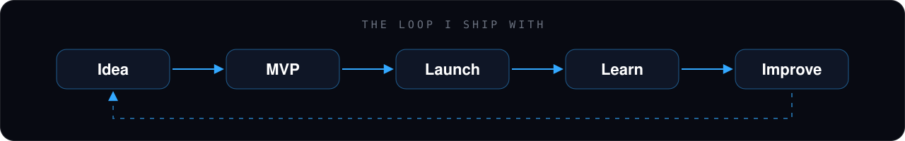

 

## 👋 Hi, I'm Dani

I'm a full-stack founder and builder. I design, ship, and maintain software end to end: music tooling, dating, e-commerce, no-code publishing. Everything I make is made by Dani, with no shortcuts and no vaporware.

Courses are next. I'm turning years of hands-on building into practical lessons for developers who want to ship their own products.

## 🚧 Building now

| Project | What it is | Status |
| :-- | :-- | :-- |
| **Ship It** | A first-person startup simulator. Go from broke bedroom coder to tech titan by solving real code puzzles, hunting bugs in live logs, and surviving 2 a.m. production meltdowns. | 🔨 In development |
| **Cliosort** | AI-powered content management for any website. Scan your site, discover what matters, and manage it without rebuilding your stack. | 🔨 In development |
| **Axis** | The next thing I'm working on. | 🔨 In development |

## 🔁 The loop I ship with

No tutorials that stop at "hello world." I teach the exact loop I use to take an idea all the way to a shipped, working product, and back again.

## 🎬 From the channel

Real builds, real launches, real lessons, the stuff behind the products.

- 💸 How to Build Product Infrastructure From Cheap to Zero Cost
- 🧭 Should you build a general or a customer specific product?
- 💘 Should Anyone Build a Dating App in 2026?
- 📦 Is Dropshipping Actually Worth It?

▶️ **[Watch on YouTube](https://www.youtube.com/@itsmadebydani)**

## 🤝 Let's build something

Working on something interesting, want to collaborate, or just want to say hi? The inbox is open: **support@itsmadebydani.com**

Built to ship. · © 2026 It's Made by Dani

